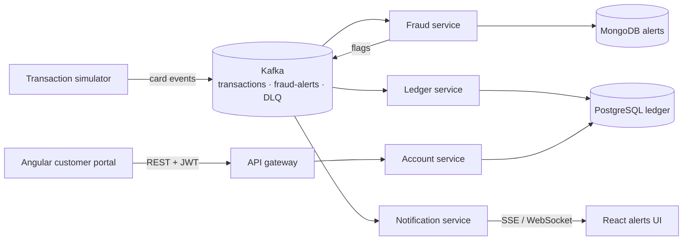
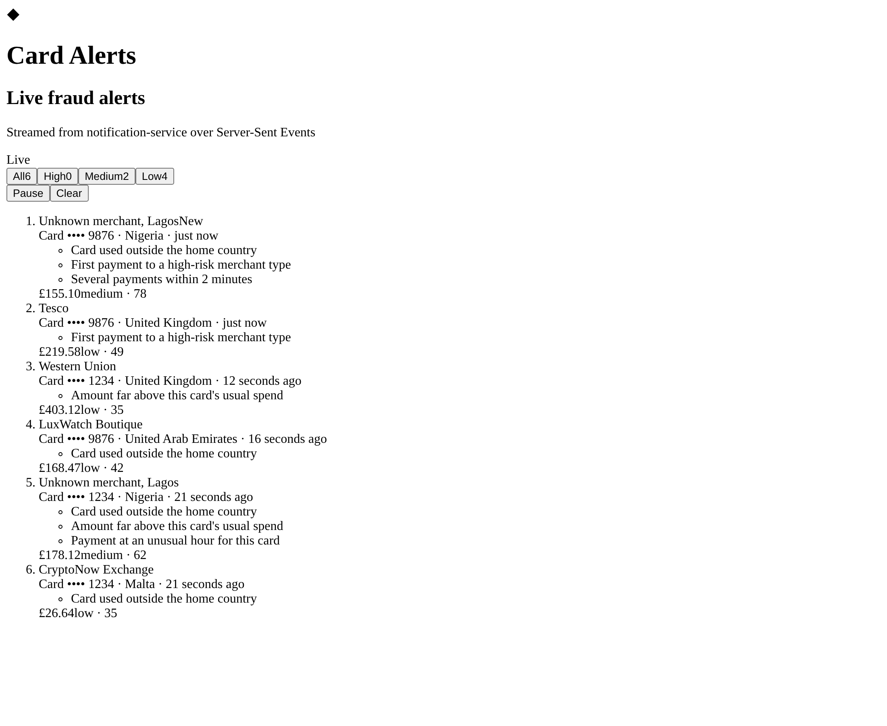

# Card Banking Platform

A real-time card banking system: a secure customer portal on top of event-driven microservices. Card swipes stream through Kafka, get scored for fraud, update the ledger exactly once, and push live alerts to the customer.

Built to mirror the stack used by large retail and investment banks: **Java / Spring Boot microservices, Angular + React front ends, Kafka, AWS, Kubernetes, Terraform and GitLab/GitHub CI**.

> Status: 🚧 in progress. See the [roadmap](#roadmap) and the GitHub Issues board.

## Architecture



## Tech stack

| Layer | Tools |
| --- | --- |
| Front end | Angular 17+, TypeScript, RxJS (portal) · React 18, Redux Toolkit / React Query (alerts UI) |
| Back end | Java 21, Spring Boot 3, Spring Security (JWT), Spring Data JPA, Spring for Apache Kafka |
| Messaging | Apache Kafka, Avro + Schema Registry, dead-letter topics |
| Data | PostgreSQL (ledger), MongoDB (alerts), Redis (cache), Flyway migrations |
| Infra | Docker, Kubernetes (EKS), Helm, Terraform, AWS (MSK, EKS, RDS, S3) |
| CI/CD | GitHub Actions, GitLab CI, SonarQube, Trivy |
| Observability | Micrometer, Prometheus, Grafana, OpenTelemetry |
| Testing | JUnit 5, Mockito, Testcontainers, PACT, Jest, Cypress, k6 |

## Repository layout

```
portal/                  Angular customer portal
alerts-ui/               React live fraud-alerts dashboard
services/
  account-service/       Spring Boot: accounts, transfers, auth
  fraud-service/         Kafka consumer: rule-based fraud scoring
  ledger-service/        Kafka consumer: exactly-once balance updates
  notification-service/  Pushes alerts to the UI over SSE
infra/terraform/         AWS infrastructure as code
infra/k8s/               Kubernetes manifests / Helm charts
docs/                    Architecture notes and decisions
```

## Roadmap

- [x] **M1 — Foundations:** account-service with REST API, PostgreSQL, Flyway, JWT auth, unit tests
- [ ] **M2 — Portal:** Angular login, dashboard, transactions page, transfers with idempotency keys
- [ ] **M3 — Events:** Kafka in Docker Compose, transaction simulator, fraud and ledger services
- [ ] **M4 — Live alerts:** notification service + React alerts UI over SSE
- [ ] **M5 — Quality:** Testcontainers, PACT contract tests, Cypress end-to-end, SonarQube gate
- [ ] **M6 — Cloud:** Docker images, Kubernetes, Terraform on AWS EKS + MSK
- [ ] **M7 — Observability & scale:** Prometheus/Grafana, OpenTelemetry, k6 load test at 1,000 events/sec

## Alerts UI (React)



React 18 + TypeScript (Vite) feed of fraud alerts pushed over Server-Sent Events, with risk filters, pause/resume, auto-reconnect and de-duplication. Until `notification-service` lands (M4), `npm run dev` serves a mock stream that follows the same contract. Details: [alerts-ui/README.md](alerts-ui/README.md).

```bash
cd alerts-ui && npm install && npm run dev   # http://localhost:5173
```

## Run locally

Needs Java 21 only: the Maven Wrapper (`mvnw`) downloads the right Maven on first run. No database install needed: by default the service uses an in-memory H2 database in PostgreSQL mode, built by the same Flyway migrations, with demo data.

```bash
cd services/account-service
./mvnw verify            # unit + integration tests (the PostgreSQL test runs too if Docker is up)
./mvnw spring-boot:run   # http://localhost:8080/swagger-ui.html
# Windows PowerShell: .\mvnw.cmd verify  /  .\mvnw.cmd spring-boot:run
```

Real PostgreSQL instead (needs Docker):

```bash
docker compose up -d                                   # from the repo root
cd services/account-service
./mvnw spring-boot:run -Dspring-boot.run.profiles=postgres
```

Try it. Demo logins are created at startup (`app.demo-users=true`, local only):

| Email | Password | Role |
| --- | --- | --- |
| alex.morgan@example.com | alex-demo-password | CUSTOMER (2 accounts) |
| priya.shah@example.com | priya-demo-password | CUSTOMER (1 account) |
| admin@example.com | admin-demo-password | ADMIN |

```powershell
# Windows PowerShell, with the service running in another terminal
$login = Invoke-RestMethod -Method Post http://localhost:8080/api/auth/login -ContentType "application/json" `
  -Body '{"email":"alex.morgan@example.com","password":"alex-demo-password"}'
$auth = @{ Authorization = "Bearer $($login.accessToken)" }
Invoke-RestMethod http://localhost:8080/api/accounts -Headers $auth
Invoke-RestMethod "http://localhost:8080/api/accounts/1/transactions?size=5&q=tesco" -Headers $auth
```

```bash
# macOS / Linux
TOKEN=$(curl -s -X POST localhost:8080/api/auth/login -H 'Content-Type: application/json' \
  -d '{"email":"alex.morgan@example.com","password":"alex-demo-password"}' | jq -r .accessToken)
curl -H "Authorization: Bearer $TOKEN" localhost:8080/api/accounts
```

In Swagger UI: call `POST /api/auth/login`, copy `accessToken`, click **Authorize** and paste it.

### Account service API (M1)

| Method | Path | Who | What it does |
| --- | --- | --- | --- |
| POST | `/api/auth/signup` | anyone | Create a customer login; returns tokens (201). Password 12-64 characters |
| POST | `/api/auth/login` | anyone | Email + password → access token (JWT, 15 min) + refresh token (7 days). 401 if wrong, **423 after 5 failures in a row** (locked 15 min) |
| POST | `/api/auth/refresh` | anyone with a refresh token | New token pair. Each refresh token works **once** |
| POST | `/api/auth/logout` | anyone | Revokes a refresh token (204) |
| GET | `/api/auth/me` | signed in | Who the token belongs to |
| GET | `/api/accounts` | CUSTOMER | The customer's accounts: masked number, type, balance, status |
| GET | `/api/accounts/{id}` | CUSTOMER | One account; **404** if it doesn't exist *or* isn't theirs, so ids can't be probed |
| GET | `/api/accounts/{id}/transactions` | CUSTOMER | Paged, newest first. Filters: `from`, `to` (YYYY-MM-DD), `direction` (CREDIT/DEBIT), `q`; `page`, `size` (1-100) |
| GET | `/api/admin/customers`, `/api/admin/users` | ADMIN | Back office: customers with account counts; logins with failed attempts and lock status |
| POST | `/api/admin/users/{id}/unlock` | ADMIN | Unlock a login |

**Security design**

- **Passwords** are hashed with BCrypt (cost 12). An unknown email costs the same time as a wrong password and gets the same message, so emails can't be discovered.
- **Access tokens** are HS256 JWTs (`sub`, `email`, `roles`, `cid` = customer id, `iss`, `exp`), checked for signature, expiry and issuer. The customer is taken from the token, never from the request. Set `JWT_SECRET` (32+ bytes) anywhere shared.
- **Refresh tokens** are random 256-bit values; only their SHA-256 hash is stored. They rotate on every use, and replaying an old one (a sign it was stolen) revokes all of that user's tokens.
- **Lockout:** 5 wrong passwords lock the login for 15 minutes; an admin can unlock it. The failed-attempt counter is saved even though the request fails (`@Transactional(noRollbackFor = …)`).
- **Roles:** `/api/accounts/**` needs CUSTOMER, `/api/admin/**` needs ADMIN. Stateless sessions; CSRF is off because tokens travel in the `Authorization` header, not cookies.
- **Errors** are RFC 7807 problem details; unexpected errors are a 500 that never leaks internals.

**Data and tests**

- **Schema** is owned by Flyway (`src/main/resources/db/migration`); money is `numeric(19,2)` / `BigDecimal`, never floating point; accounts carry a `version` column for optimistic locking.
- **Tests:** controller tests with signed test JWTs and a Mockito service; auth rules (lockout, rotation, reuse detection, hashing) with Mockito and a movable clock; end-to-end HTTP tests for every auth flow, including expired, wrong-issuer and tampered tokens; repository tests on H2 and on real PostgreSQL 16 via **Testcontainers**.

## Related

Analytics and AI on this platform's data live in [card-risk-analytics](https://github.com/mukesh132001/card-risk-analytics).
