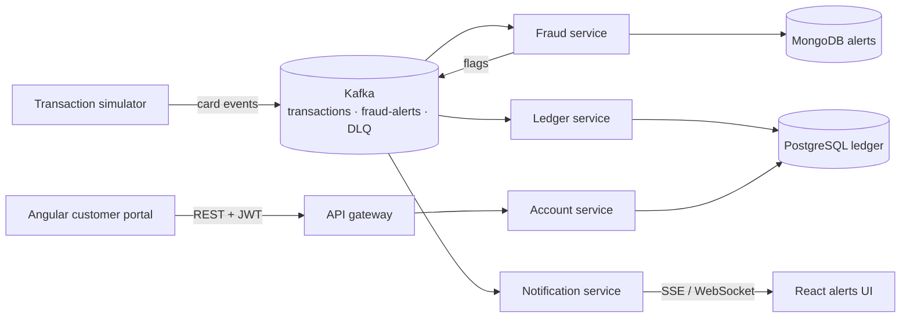

# Card Banking Platform

A real-time card banking system: a secure customer portal on top of event-driven microservices. Card swipes stream through Kafka, get scored for fraud, update the ledger exactly once, and push live alerts to the customer.

Built to mirror the stack used by large retail and investment banks: **Java / Spring Boot microservices, Angular + React front ends, Kafka, AWS, Kubernetes, Terraform and GitLab/GitHub CI**.

> Status: 🚧 in progress. See the [roadmap](#roadmap) and the GitHub Issues board.

## Architecture



## Tech stack

| Layer | Tools |
| --- | --- |
| Front end | Angular 17+, TypeScript, RxJS (portal) · React 18, Redux Toolkit / React Query (alerts UI) |
| Back end | Java 21, Spring Boot 3, Spring Security (JWT), Spring Data JPA, Spring for Apache Kafka |
| Messaging | Apache Kafka, Avro + Schema Registry, dead-letter topics |
| Data | PostgreSQL (ledger), MongoDB (alerts), Redis (cache), Flyway migrations |
| Infra | Docker, Kubernetes (EKS), Helm, Terraform, AWS (MSK, EKS, RDS, S3) |
| CI/CD | GitHub Actions, GitLab CI, SonarQube, Trivy |
| Observability | Micrometer, Prometheus, Grafana, OpenTelemetry |
| Testing | JUnit 5, Mockito, Testcontainers, PACT, Jest, Cypress, k6 |

## Repository layout

```
portal/                  Angular customer portal
alerts-ui/               React live fraud-alerts dashboard
services/
  account-service/       Spring Boot: accounts, transfers, auth
  fraud-service/         Kafka consumer: rule-based fraud scoring
  ledger-service/        Kafka consumer: exactly-once balance updates
  notification-service/  Pushes alerts to the UI over SSE
infra/terraform/         AWS infrastructure as code
infra/k8s/               Kubernetes manifests / Helm charts
docs/                    Architecture notes and decisions
```

## Roadmap

- [ ] **M1 — Foundations:** account-service with REST API, PostgreSQL, Flyway, JWT auth, unit tests
- [ ] **M2 — Portal:** Angular login, dashboard, transactions page, transfers with idempotency keys
- [ ] **M3 — Events:** Kafka in Docker Compose, transaction simulator, fraud and ledger services
- [ ] **M4 — Live alerts:** notification service + React alerts UI over SSE
- [ ] **M5 — Quality:** Testcontainers, PACT contract tests, Cypress end-to-end, SonarQube gate
- [ ] **M6 — Cloud:** Docker images, Kubernetes, Terraform on AWS EKS + MSK
- [ ] **M7 — Observability & scale:** Prometheus/Grafana, OpenTelemetry, k6 load test at 1,000 events/sec

## Run locally

Needs Java 21 only: the Maven Wrapper (`mvnw`) downloads the right Maven on first run. No database install needed: by default the service uses an in-memory H2 database in PostgreSQL mode, built by the same Flyway migrations, with demo data.

```bash
cd services/account-service
./mvnw verify            # unit + integration tests (the PostgreSQL test runs too if Docker is up)
./mvnw spring-boot:run   # http://localhost:8080/swagger-ui.html
# Windows PowerShell: .\mvnw.cmd verify  /  .\mvnw.cmd spring-boot:run
```

Real PostgreSQL instead (needs Docker):

```bash
docker compose up -d                                   # from the repo root
cd services/account-service
./mvnw spring-boot:run -Dspring-boot.run.profiles=postgres
```

Try it (demo customer 1 is Alex Morgan, 2 is Priya Shah):

```bash
curl -H "X-Customer-Id: 1" http://localhost:8080/api/accounts
curl -H "X-Customer-Id: 1" "http://localhost:8080/api/accounts/1/transactions?size=5&q=tesco"
```

### Account service API (M1)

| Method | Path | What it returns |
| --- | --- | --- |
| GET | `/api/accounts` | The customer's accounts: masked number, type, balance, status |
| GET | `/api/accounts/{id}` | One account; **404** if it doesn't exist *or* belongs to someone else, so ids can't be probed |
| GET | `/api/accounts/{id}/transactions` | Paged, newest first. Filters: `from`, `to` (YYYY-MM-DD), `direction` (CREDIT/DEBIT), `q` (description or merchant); `page`, `size` (1-100) |

- **Errors** are RFC 7807 problem details (`title`, `status`, `detail`); bad input is a 400 with the reason, unexpected errors are a 500 that never leaks internals.
- **Schema** is owned by Flyway (`src/main/resources/db/migration`); money is `numeric(19,2)` / `BigDecimal`, never floating point; accounts carry a `version` column for optimistic locking.
- **Tests:** controller tests with a Mockito-mocked service, service rules with plain Mockito, repository tests on H2, the same repository checks on real PostgreSQL 16 via **Testcontainers**, and end-to-end HTTP tests on the demo data.
- **Who is the customer?** For now the `X-Customer-Id` header. JWT login (M1, issue 3) replaces it with the signed-in user.

## Related

Analytics and AI on this platform's data live in [card-risk-analytics](https://github.com/mukesh132001/card-risk-analytics).
