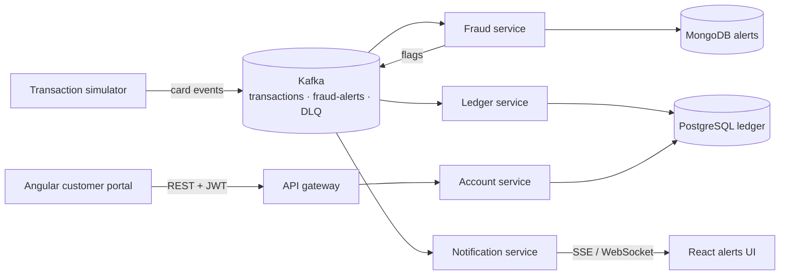

# Card Banking Platform

A real-time card banking system: a secure customer portal on top of event-driven microservices. Card swipes stream through Kafka, get scored for fraud, update the ledger exactly once, and push live alerts to the customer.

Built to mirror the stack used by large retail and investment banks: **Java / Spring Boot microservices, Angular + React front ends, Kafka, AWS, Kubernetes, Terraform and GitLab/GitHub CI**.

> Status: 🚧 in progress. See the [roadmap](#roadmap) and the GitHub Issues board.

## Architecture



## Tech stack

| Layer | Tools |
| --- | --- |
| Front end | Angular 17+, TypeScript, RxJS (portal) · React 18, Redux Toolkit / React Query (alerts UI) |
| Back end | Java 21, Spring Boot 3, Spring Security (JWT), Spring Data JPA, Spring for Apache Kafka |
| Messaging | Apache Kafka, Avro + Schema Registry, dead-letter topics |
| Data | PostgreSQL (ledger), MongoDB (alerts), Redis (cache), Flyway migrations |
| Infra | Docker, Kubernetes (EKS), Helm, Terraform, AWS (MSK, EKS, RDS, S3) |
| CI/CD | GitHub Actions, GitLab CI, SonarQube, Trivy |
| Observability | Micrometer, Prometheus, Grafana, OpenTelemetry |
| Testing | JUnit 5, Mockito, Testcontainers, PACT, Jest, Cypress, k6 |

## Repository layout

```
portal/                  Angular customer portal
alerts-ui/               React live fraud-alerts dashboard
services/
  account-service/       Spring Boot: accounts, transfers, auth
  fraud-service/         Kafka consumer: rule-based fraud scoring
  ledger-service/        Kafka consumer: exactly-once balance updates
  notification-service/  Pushes alerts to the UI over SSE
infra/terraform/         AWS infrastructure as code
infra/k8s/               Kubernetes manifests / Helm charts
docs/                    Architecture notes and decisions
```

## Roadmap

- [ ] **M1 — Foundations:** account-service with REST API, PostgreSQL, Flyway, JWT auth, unit tests
- [ ] **M2 — Portal:** Angular login, dashboard, transactions page, transfers with idempotency keys
- [ ] **M3 — Events:** Kafka in Docker Compose, transaction simulator, fraud and ledger services
- [ ] **M4 — Live alerts:** notification service + React alerts UI over SSE
- [ ] **M5 — Quality:** Testcontainers, PACT contract tests, Cypress end-to-end, SonarQube gate
- [ ] **M6 — Cloud:** Docker images, Kubernetes, Terraform on AWS EKS + MSK
- [ ] **M7 — Observability & scale:** Prometheus/Grafana, OpenTelemetry, k6 load test at 1,000 events/sec

## Run locally

```bash
cd services/account-service
mvn spring-boot:run
# http://localhost:8080/api/health
```

## Related

Analytics and AI on this platform's data live in [card-risk-analytics](https://github.com/mukesh132001/card-risk-analytics).
