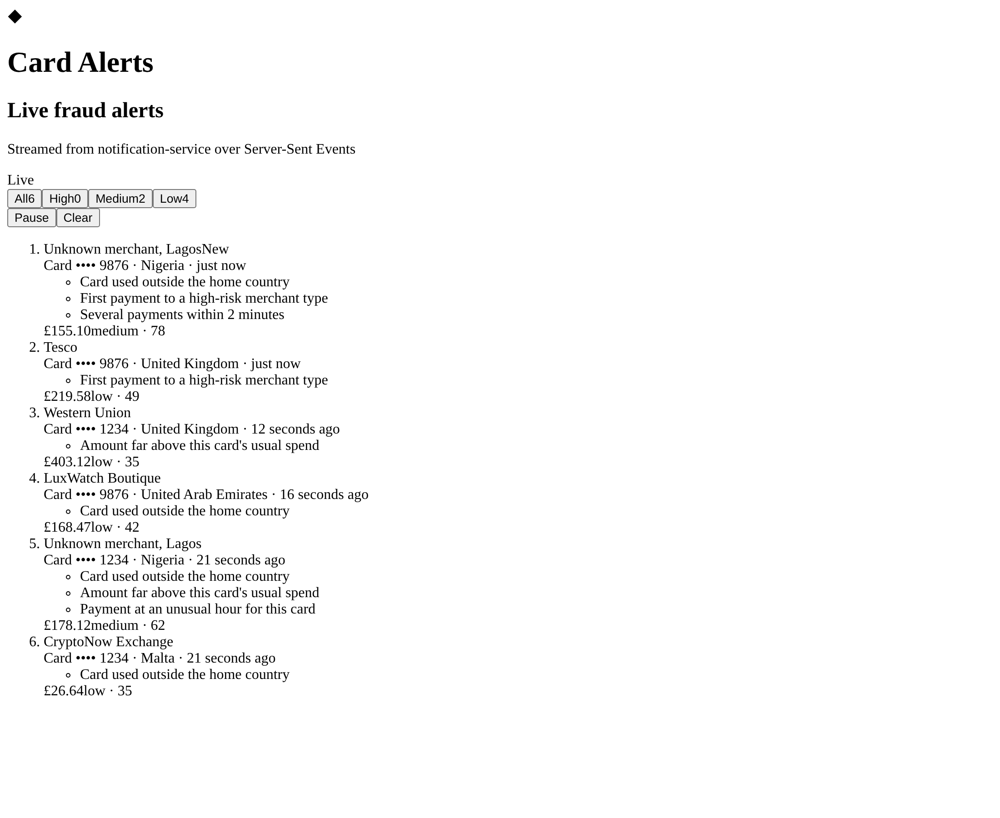

# alerts-ui

React 18 + TypeScript (Vite) dashboard that shows card fraud alerts the moment they happen, streamed from `notification-service` over **Server-Sent Events**.



## Run it

Needs Node 20+.

```bash
cd alerts-ui
npm install
npm run dev        # http://localhost:5173, with a built-in mock alert stream
npm run build      # type-check + production build into dist/
```

`npm run dev` serves a **mock SSE stream** (`mock/alertsMock.ts`) so the UI works before the Kafka pipeline (M3) and `notification-service` (M4) exist. To stream from the real service instead:

```bash
npm run dev:live   # proxies /api/alerts -> localhost:8082, /api -> localhost:8080
```

Override the targets with `NOTIFICATION_SERVICE_URL` / `ACCOUNT_SERVICE_URL`, or point the browser straight at another stream with `VITE_ALERTS_STREAM_URL` (see `.env.example`).

## Stream contract

`notification-service` must serve this; the mock follows it exactly.

```
GET /api/alerts/stream          Accept: text/event-stream

retry: 3000

event: fraud-alert
id: alrt-000042
data: {"alertId":"alrt-000042","transactionId":"txn-…","accountId":1,"cardLast4":"1234",
       "merchant":"CryptoNow Exchange","merchantCountry":"MT","category":"CRYPTO",
       "amount":"1249.99","currency":"GBP","riskScore":0.91,
       "reasons":[{"code":"FOREIGN_COUNTRY","description":"Card used outside the home country"}],
       "occurredAt":"2026-11-10T15:43:53Z","status":"OPEN"}
```

- `amount` is a decimal **string**, matching the backend's `BigDecimal` money; it's never parsed into float arithmetic.
- `id:` lets the browser resume: on reconnect it sends `Last-Event-ID` and the server replays only newer alerts.
- Comment lines (`: keep-alive`) every 15 s stop proxies and load balancers from closing an idle stream.

Full type: [`src/types/alert.ts`](src/types/alert.ts).

## How the feed works

| Piece | File | What it does |
| --- | --- | --- |
| `useAlertStream` | `src/hooks/useAlertStream.ts` | Opens the `EventSource`, validates each message, tracks `connecting / live / reconnecting / paused`. The browser retries network drops on its own; if it gives up (non-200), the hook retries with capped exponential backoff (1 s → 30 s). |
| `addAlert` | `src/hooks/alertsReducer.ts` | Pure: newest first, de-duplicated by `alertId` (replays after reconnect), capped at 50 so a tab left open doesn't grow forever. |
| `AlertsFeed` | `src/components/AlertsFeed.tsx` | Risk filter chips with live counts, pause/resume, clear, empty states. New alerts are announced to screen readers (`aria-live`). |
| `AlertCard` | `src/components/AlertCard.tsx` | Merchant, masked card, country, amount, risk score (high ≥ 0.8, medium ≥ 0.5) and the rules that fired. |

Malformed messages are logged and skipped, so one bad event can't break the feed.

## Layout

```
alerts-ui/
  mock/alertsMock.ts      dev-only SSE stand-in (Vite plugin)
  src/
    components/           AlertsFeed, AlertCard, StatusBadge
    hooks/                useAlertStream, alertsReducer
    lib/format.ts         money, relative time, country names (Intl)
    types/alert.ts        FraudAlert contract + runtime guard
    styles/               Sass partials: tokens (light/dark), base, feed
```

## Next

Transactions table (React Query), alert detail with "confirm fraud / not me", JWT login, Jest + Cypress tests, deploy.
